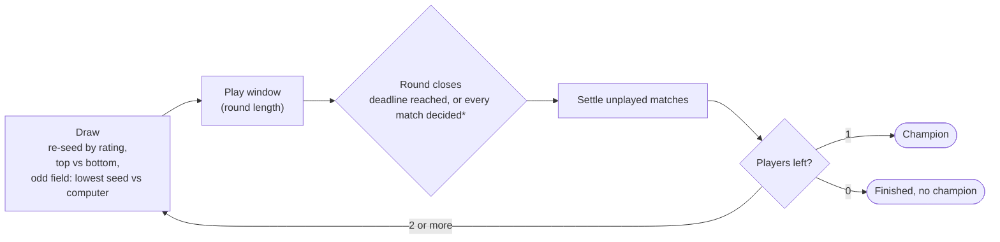
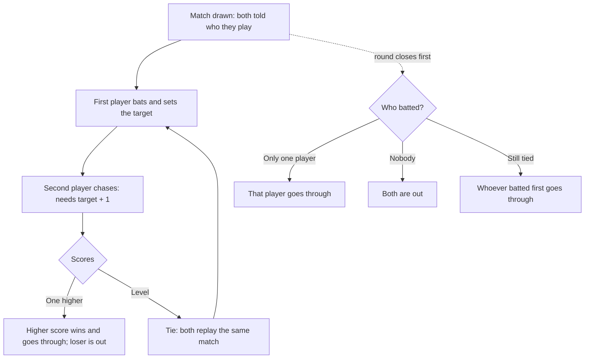

# Match and round

## A round

\* Round 1 with buybacks on (and not a final) always waits for its deadline, so knocked-out players
can buy back.

## A match

**Computer opponent:** bats after the human and finishes a few runs either side of their score
(it wins about 40% of the time); it never goes through to the next round.

**Buyback:** a player who loses in round 1 can pay before round 1 closes (never in a final) and
joins the round 2 draw. A late payment is refunded automatically.
