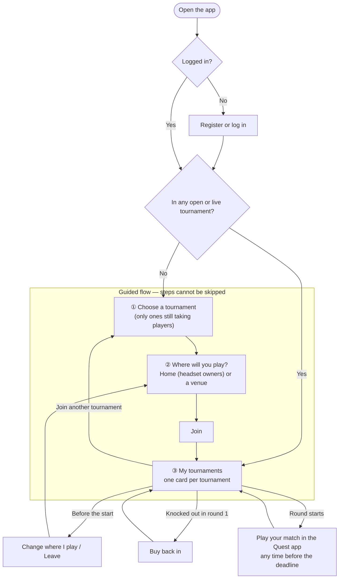

# Player journey

**Locked in:** the menu only has *My tournaments* and *Profile*; step ② only opens for a
tournament that can still be joined; old links (venues, bookings, matches) lead back into the flow.
