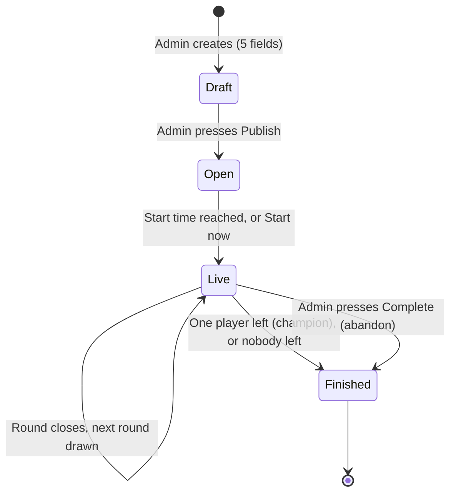

# Tournament lifecycle

| Step | Triggered by |
|---|---|
| Draft → Open | Admin (**Publish**) |
| Open → Live | Automatic at the start time, or admin (**Start now**, 2+ players) |
| Round → next round | Automatic at the round deadline, or as soon as every match is decided, or admin (**Close round now**) |
| Live → Finished | Automatic when one player is left |

While **Open**, players join with a venue or Home and can change or leave until the start. While
**Live**, each round is draw → play window → settle, and buybacks are only possible in round 1.
The draw engine (worker job `draw-rounds`) checks every 15 seconds.
